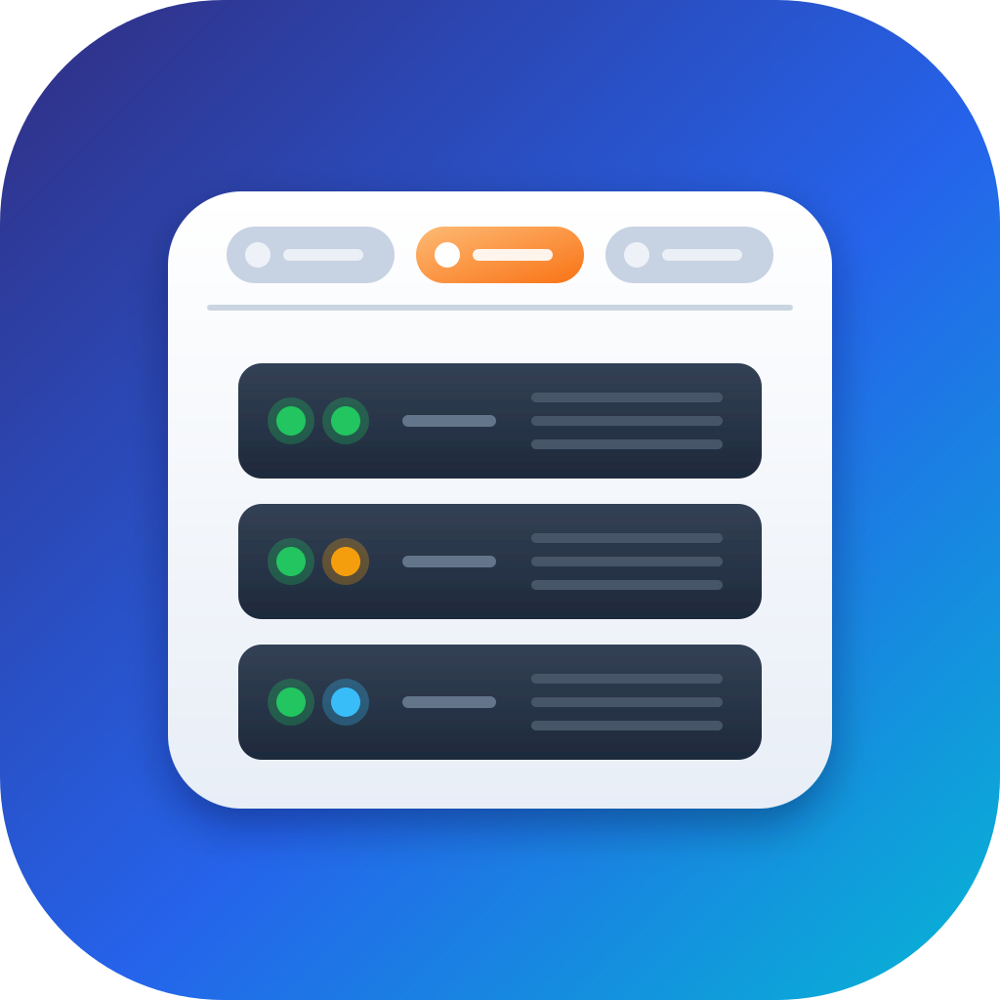

<p align="center">
  
</p>

<h1 align="center">LabPanel</h1>

<p align="center">
  <a href="https://github.com/Aervorn/MacOS_LabPanel/releases/latest"></a>
  
  
  <a href="LICENSE"></a>
</p>

<p align="center">
  <a href="README.md">🇬🇧 English</a> · 🇫🇷 Français
</p>

---

LabPanel réunit les interfaces web de ton **homelab** dans une seule fenêtre macOS native, un onglet par service : UniFi, Synology DSM, Proxmox, Dockhand, AdGuard Home, Nginx Proxy Manager, NUT, Home Assistant, Zigbee2MQTT… ou n'importe quelle autre adresse.

Chaque page reste ouverte quand tu changes d'onglet, garde sa propre connexion, et une pastille sur chaque onglet indique d'un coup d'œil si le service répond. L'interface est en français et en anglais (elle suit la langue de ton Mac), en mode clair ou sombre.

> [!NOTE]
> **Conçue avec l'aide de l'IA.** LabPanel est un projet personnel réalisé avec [Claude](https://claude.ai), l'assistant IA d'Anthropic : mes compétences seules n'auraient pas suffi à la coder entièrement moi-même. J'ai décidé de ce que l'app devait faire, fait les choix de conception et testé chaque version sur mon propre homelab ; Claude a écrit une grande partie du code. Autant le dire franchement.

## 📸 Captures d'écran

<!-- Ajoute ici tes captures : docs/screenshots/tabs.png, setup.png, settings.png -->
*Bientôt.*

## ✨ Fonctionnalités

### 🗂️ Onglets dans la barre de titre

- Une **barre d'onglets en verre** (style macOS 26) en haut de la fenêtre : chaque service a son icône et sa couleur, et la surbrillance glisse d'un onglet à l'autre.
- Quand la fenêtre se rétrécit, les onglets ne gardent que leur icône (l'onglet ouvert garde son nom).
- **⌘1 … ⌘9** pour aller à un onglet, **⌃⇥ / ⌃⇧⇥** pour passer au suivant ou au précédent.
- Clic droit sur un onglet : recharger, revenir à l'accueil du service, ouvrir dans le navigateur, copier l'adresse, modifier, masquer.

### 🌐 Des pages qui restent ouvertes

- Changer d'onglet **ne recharge rien** : tu retrouves Proxmox, Home Assistant ou DSM là où tu les avais laissés. Fermer la fenêtre puis la rouvrir (icône du Dock) les garde aussi.
- **Cookies séparés par service** : les cookies ignorent le port ; sans cette séparation, deux services du même NAS (DSM sur `:5001`, Dockhand sur `:3000`) se déconnecteraient l'un l'autre. Les connexions sont gardées d'un lancement à l'autre.
- Les **fenêtres surgissantes** (console noVNC de Proxmox, visionneuses de DSM…) s'ouvrent dans leur propre fenêtre, avec la même connexion.
- Les **téléchargements** (sauvegardes de Home Assistant, fichiers de DSM…) vont dans ton dossier Téléchargements ; l'**envoi de fichiers**, les dialogues JavaScript et les mots de passe HTTP (Basic/Digest) fonctionnent comme dans un navigateur.
- Précédent / Suivant / Recharger, **zoom par service** (⌘+ ⌘− ⌘0), ⌘-clic sur un lien pour l'ouvrir dans ton navigateur, et l'Inspecteur web (clic droit › Inspecter l'élément).
- Le mode clair ou sombre est transmis aux pages qui le gèrent (Home Assistant, AdGuard, Zigbee2MQTT…).

### 🔐 Certificats auto-signés

Les consoles de Proxmox, DSM et UniFi arrivent avec un certificat auto-signé. LabPanel l'accepte **pour l'hôte du service seulement** : d'office pour ces trois-là, au choix pour les autres. Si une page est bloquée par son certificat, l'écran d'erreur propose un bouton **Faire confiance**.

### 🟢 Disponibilité

Chaque minute (et quand tu reviens sur l'app ou que le Mac sort de veille), LabPanel vérifie que chaque service répond : pastille **verte** s'il répond, **orange** si son certificat n'est pas accepté, **rouge** si rien ne répond. L'infobulle donne le temps de réponse. Désactivable dans les Réglages.

### ⚙️ Réglages

- Les neuf services de départ, et autant de **services personnalisés** que tu veux.
- Glisser pour réordonner les onglets, masquer un onglet sans le supprimer.
- Nom, adresse, **couleur** et **icône** (n'importe quel [SF Symbol](https://developer.apple.com/sf-symbols/)) de chaque service.
- **Effacer les cookies et les données** d'un service (te déconnecte de celui-ci seulement).
- Apparence : automatique, claire ou sombre.

## 🧩 Compatibilité

**macOS 26 (Tahoe) ou plus récent**, sur Mac Apple Silicon et Intel.

Toute interface web joignable depuis ton Mac convient : réseau local, VPN (Headscale/Tailscale, WireGuard, UniFi Teleport…) ou reverse proxy.

## ⚙️ Premiers pas

1. Clique sur un onglet : LabPanel demande l'adresse du service, comme tu la taperais dans un navigateur (`pve.local:8006`, `192.168.1.1`, `https://ha.exemple.fr`). Sans schéma, `https://` est ajouté pour UniFi, DSM, Proxmox et les ports HTTPS habituels (443, 5001, 8006, 8443, 9443), `http://` sinon.
2. Connecte-toi comme d'habitude : LabPanel s'en souvient.
3. **Réglages (⌘,) › Services** pour réordonner les onglets, masquer ceux dont tu ne te sers pas ou ajouter les tiens.

## ⌨️ Raccourcis clavier

| Raccourci | Action |
|---|---|
| ⌘1 … ⌘9 | Aller à l'onglet 1 … 9 |
| ⌃⇥ / ⌃⇧⇥ | Onglet suivant / précédent |
| ⌘R / ⇧⌘R | Recharger / recharger sans le cache |
| ⇧⌘H | Revenir à l'accueil du service |
| ⌘[ / ⌘] | Page précédente / suivante |
| ⌘+ / ⌘− / ⌘0 | Agrandir / réduire / taille réelle |
| ⌥⌘O | Ouvrir dans le navigateur par défaut |
| ⇧⌘C | Copier l'adresse de la page |
| ⌘, | Réglages |

## 🔐 Autorisations nécessaires

| Autorisation | Pourquoi | Quand |
|---|---|---|
| **Réseau local** | Joindre les services de ton réseau. | Au premier lancement : clique sur **Autoriser**. Si tu as refusé, réactive-la dans **Réglages Système › Confidentialité et sécurité › Réseau local**. |

## 🔒 Confidentialité

LabPanel ne collecte et n'envoie rien sur toi : ni compte, ni statistiques, ni pistage. Les seules requêtes réseau sont :

- les pages de tes services, aux adresses que tu as saisies ;
- la vérification de disponibilité (un `GET` par minute vers chaque service affiché, dont le contenu n'est pas lu) ;
- les mises à jour (ce dépôt GitHub).

Les cookies et données des sites sont rangés par WebKit dans ta bibliothèque utilisateur, séparément pour chaque service. Les mots de passe saisis dans les pages sont gérés par les pages elles-mêmes ; les mots de passe HTTP restent en mémoire, pour la session seulement.

## 📥 Installation

1. Télécharge `LabPanel-x.y.z.dmg` depuis la [dernière version](https://github.com/Aervorn/MacOS_LabPanel/releases/latest).
2. Ouvre-le et glisse **LabPanel** sur le dossier **Applications**.
3. Lance LabPanel depuis ton dossier Applications.

> [!WARNING]
> **LabPanel n'est pas notarisée par Apple.** Elle est signée avec le certificat de son auteur, pas avec un compte Apple Developer payant : macOS la bloque donc à la première ouverture. C'est normal, il suffit de l'autoriser une fois :
>
> 1. Ouvre LabPanel : macOS indique qu'il ne peut pas la vérifier. Clique sur **Terminé**.
> 2. Ouvre **Réglages Système › Confidentialité et sécurité** et descends jusqu'à la section **Sécurité**.
> 3. À côté du message concernant LabPanel, clique sur **Ouvrir quand même**, puis confirme avec ton mot de passe.
>
> Si tu préfères le Terminal : `xattr -dr com.apple.quarantine /Applications/LabPanel.app`
>
> Tu peux vérifier que le téléchargement est authentique en comparant son empreinte SHA-256 (`shasum -a 256 LabPanel-x.y.z.dmg`) avec celle des notes de version.

## 🔄 Mises à jour

LabPanel se met à jour toute seule : elle cherche une nouvelle version une fois par jour et propose de l'installer, avec ses notes (ou **LabPanel › Rechercher les mises à jour…**). Les mises à jour sont signées, et LabPanel refuse tout fichier qui n'a pas été signé par son auteur. La recherche automatique se désactive dans **Réglages › Mises à jour**. Tes services et tes connexions sont conservés.

## 📝 Historique

### 0.1.0
- Première version.
- Onglets dans la barre de titre avec l'icône et la couleur de chaque service, surbrillance qui glisse, mode compact, ⌘1…⌘9.
- Neuf services de départ (UniFi, DSM, Proxmox, Dockhand, AdGuard, NPM, NUT, Home Assistant, Zigbee2MQTT) et services personnalisés.
- Pages gardées ouvertes, cookies séparés par service, fenêtres surgissantes, téléchargements, envoi de fichiers, mots de passe HTTP.
- Certificats auto-signés acceptés service par service, bouton **Faire confiance** sur les erreurs de certificat.
- Pastille de disponibilité sur chaque onglet.
- Interface en français et en anglais, apparence claire/sombre/automatique, icône pensée pour macOS 26, mises à jour Sparkle.

## 🛠️ Compiler depuis les sources

Prérequis : Xcode 26 ou plus récent, macOS 26 ou plus récent, et [XcodeGen](https://github.com/yonaskolb/XcodeGen) (le projet Xcode est généré à partir de `project.yml`).

```bash
brew install xcodegen
git clone https://github.com/Aervorn/MacOS_LabPanel.git
cd MacOS_LabPanel
xcodegen generate
open LabPanel.xcodeproj
```

Choisis le schéma **LabPanel** et **Mon Mac**, puis **Product › Run** (⌘R). Les tests se lancent avec **Product › Test** (⌘U). Le projet est réglé en **Sign to Run Locally** : pas besoin de compte développeur Apple. Après un `git pull` qui ajoute ou supprime des fichiers, relance `xcodegen generate`.

```
LabPanel/
├── LabPanelApp.swift       point d'entrée, fenêtres, menus et raccourcis
├── Core/                   logique sans interface (testée) : services, adresses, disponibilité
├── Services/               pages web (WebKit), liste des services, vérifications, dialogues, mises à jour
├── Views/                  interface SwiftUI : barre d'onglets, page du service, réglages, À propos
├── Localizable.xcstrings   textes de l'interface, en français (source) et en anglais
└── AppIcon.icon            icône de l'app (Icon Composer)
LabPanelTests/              tests (Swift Testing)
Design/                     calques de l'icône, fond du DMG et les scripts qui les génèrent
scripts/make-dmg.sh         fabrique le DMG d'une version et l'appcast de Sparkle
```

Les textes de l'interface sont écrits en français dans le code ; leur traduction anglaise est dans `Localizable.xcstrings` (Xcode y ajoute les nouveaux textes à chaque build : traduis-les dans l'éditeur de catalogue de chaînes d'Xcode).

Pour fabriquer un DMG comme ceux qui sont publiés, `scripts/make-dmg.sh` génère le projet, archive l'app, vérifie sa signature et crée l'image disque. Il lui faut [create-dmg](https://github.com/create-dmg/create-dmg) (`brew install create-dmg`) et un certificat de signature, dont le nom est indiqué en tête du script. Il signe aussi le DMG pour Sparkle et réécrit `appcast.xml`, ce qui demande une clé EdDSA dans ton trousseau (`generate_keys`, fourni avec Sparkle) dont la partie publique est dans `project.yml`.

## 🤝 Contribuer et signaler un problème

Les signalements de bugs, idées et pull requests sont les bienvenus !

- **Un bug ?** [Ouvre une issue](https://github.com/Aervorn/MacOS_LabPanel/issues/new) avec ta version de macOS, le service concerné (et sa version), ce que tu as fait et ce qui s'est passé.
- **Une page qui ne marche pas dans LabPanel mais marche dans Safari ?** Dis laquelle : c'est souvent une fenêtre surgissante, un téléchargement ou un certificat à gérer.
- **Une pull request ?** Garde-la centrée sur un seul changement, vérifie que les tests passent (⌘U), et ajoute la traduction anglaise de tout nouveau texte.

## ⚠️ Avertissement

LabPanel est fournie **« telle quelle », sans aucune garantie**. Son auteur ne peut être tenu responsable d'aucune perte de données ni d'aucun autre dommage, y compris du fait d'actions faites dans les interfaces qu'elle affiche.

LabPanel n'est affiliée ni à Ubiquiti, ni à Synology, ni à Proxmox, AdGuard, Home Assistant, Zigbee2MQTT, Nginx Proxy Manager, Network UPS Tools, Dockhand ou tout autre projet dont elle affiche l'interface. Leurs noms ne servent qu'à décrire le fonctionnement de l'app.

## 📄 Licence

LabPanel est distribuée sous [licence MIT](LICENSE).

Les mises à jour utilisent [Sparkle](https://sparkle-project.org), distribué sous licence MIT.
