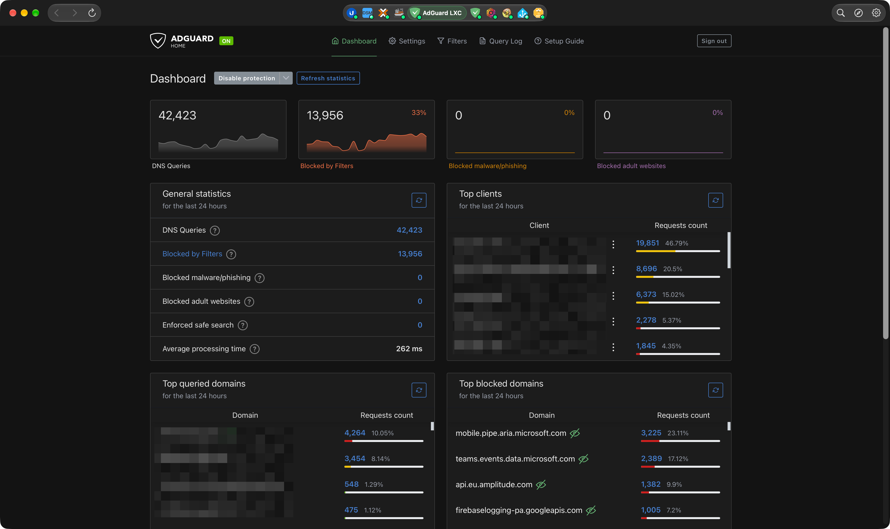
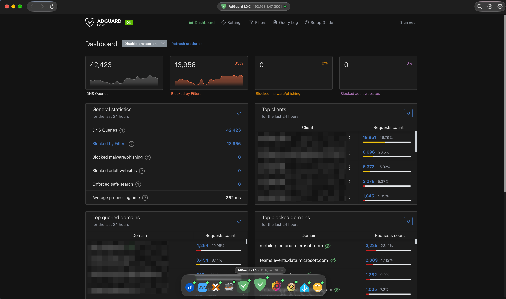
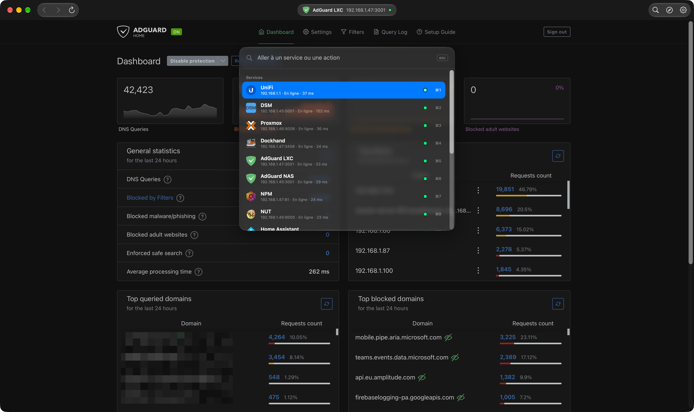
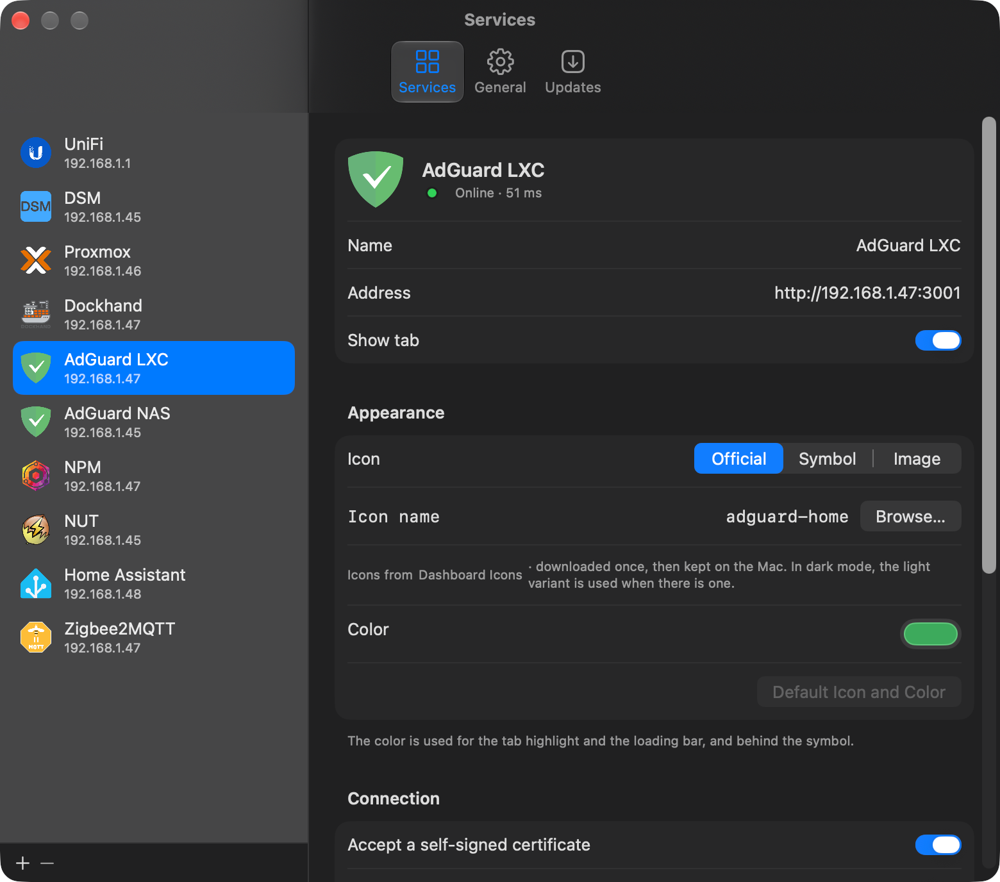

<p align="center">
  
</p>

<h1 align="center">LabPanel</h1>

<p align="center">
  <a href="https://github.com/Aervorn/MacOS_LabPanel/releases/latest"></a>
  
  
  <a href="LICENSE"></a>
</p>

<p align="center">
  🇬🇧 English · <a href="README.fr.md">🇫🇷 Français</a>
</p>

---

LabPanel gathers the web interfaces of your **homelab** in a single native macOS window, one tab per service: UniFi, Synology DSM, Proxmox, Dockhand, AdGuard Home, Nginx Proxy Manager, NUT, Home Assistant, Zigbee2MQTT… or any other address.

Each page stays alive when you switch tabs, keeps its own sign-in, and a dot on each tab tells you at a glance whether the service is responding. The interface is in English and French (it follows your Mac's language), in light or dark mode.

> [!NOTE]
> **Built with the help of AI.** LabPanel is a personal project I built with [Claude](https://claude.ai), Anthropic's AI assistant: my skills alone wouldn't have been enough to code it entirely by myself. I decided what the app should do, made the design choices and tested every version on my own homelab; Claude wrote a large part of the code. Just being upfront about it.

## 📸 Screenshots

<p align="center">
  
  
</p>
<p align="center">
  
  
</p>

## ✨ Features

### 🗂️ Tabs: capsule or dock

Two styles to choose from in **Settings › General**:

- **Capsule at the top**: a glass tab bar (macOS 26 style) in the title bar. Each service has its icon and color, only the open tab shows its name, and the highlight slides from one tab to the next. You can show every tab's name if the window is wide enough.
- **Dock at the bottom**: a floating glass dock, with icons that grow under the pointer like the macOS Dock, the service's name and status above the icon, and a dot under the open tab. It hides itself and shows up when the pointer reaches the bottom of the window, or stays visible with the page leaving room for it.

And with either style:

- **Quick switcher (⌘K)**: type a few letters (`prox`, `ha` for Home Assistant, part of an address), Enter, and you're there. It also offers the common actions for the service: reload, fill login, open in browser, unload, edit.
- **⌘1 … ⌘9** to jump to a tab, **⌃⇥ / ⌃⇧⇥** to go to the next or previous one.
- Right-click a tab: reload, go back to the service's home page, unload, open in your browser, copy the address, edit, hide.
- **Official icons** for each service, from [Dashboard Icons](https://dashboardicons.com) (the collection used by Homarr and Homepage), with their light variant in dark mode. Or any SF Symbol, or your own image.

### 🌐 Pages that stay alive

- Switching tabs **doesn't reload anything**: you find Proxmox, Home Assistant or DSM exactly where you left them. Closing the window and reopening it (Dock icon) keeps them too.
- **Separate cookies per service**: cookies ignore the port, so without this, two services on the same NAS (DSM on `:5001`, Dockhand on `:3000`) would sign each other out. Sign-ins are kept between launches.
- **Pop-up windows** (Proxmox's noVNC console, DSM viewers…) open in their own window, with the same sign-in.
- **Downloads** (Home Assistant backups, DSM files…) go to your Downloads folder; **file uploads**, JavaScript dialogs and HTTP passwords (Basic/Digest) work as in a browser.
- Back / Forward / Reload, **page zoom per service** (⌘+ ⌘− ⌘0), ⌘-click a link to open it in your default browser, and Web Inspector (right-click › Inspect Element).
- Light or dark mode is passed on to pages that support it (Home Assistant, AdGuard, Zigbee2MQTT…).

### 💤 Inactive tabs unloaded

Like Safari or Chrome, LabPanel can unload tabs you haven't looked at for a while (5, 15, 30 minutes or an hour, or never) to free their memory. An unloaded tab appears dimmed and reopens **at the same page** when you come back; cookies are kept, so you stay signed in as long as the service hasn't expired your session. If the Mac runs low on memory, background tabs are unloaded right away.

Each service can be exempted: **Proxmox is by default**, because it ends your session two hours after its page is closed.

### 🔐 Self-signed certificates

Proxmox, DSM and UniFi consoles ship with a self-signed certificate. LabPanel accepts it **for that service's host only**, on by default for these three and optional for the others. If a page is blocked by its certificate, the error screen offers a **Trust** button.

### 🔑 Automatic sign-in

For services that keep signing you out (Proxmox…), LabPanel can fill the login form with a username and password stored in your **Mac's keychain**, and submit it if you like. It handles forms built after the page loads (Proxmox), two-step logins (DSM) and forms inside Shadow DOM (Home Assistant).

- The filling script runs in an isolated JavaScript world the page can't see, and the app only gives the login to pages on the service's own host.
- If sign-in fails, the form isn't submitted again for two minutes, so a wrong password can't lock your account.
- **Fill Login** (⌥⌘L, or right-click a tab) fills the current page at any time.
- The password is only read from the keychain when a login form shows up. With a development build (run from Xcode), macOS asks for keychain access again after each build, because the signature changes: click **Always Allow**.

### 🟢 Availability

Once a minute (and when you come back to the app or the Mac wakes up), LabPanel checks that each service responds: **green** dot if it does, **orange** if its certificate isn't accepted, **red** if nothing answers. The tooltip shows the response time. Can be turned off in Settings.

### ⚙️ Settings

- The nine starting services, plus as many **custom services** as you like.
- Drag to reorder tabs, hide a tab without deleting it.
- Name, address, **color** and **icon** of each service: official icon (with a search through the 3,000+ icons of Dashboard Icons), [SF Symbol](https://developer.apple.com/sf-symbols/) or an image from your Mac.
- **Clear cookies and data** of one service (signs you out of it only).
- Appearance: automatic, light or dark.
- **Language**: system, English or French (applied after a relaunch).

## 🧩 Compatibility

**macOS 26 (Tahoe) or later**, on Apple Silicon and Intel Macs.

Any web interface reachable from your Mac works: local network, VPN (Headscale/Tailscale, WireGuard, UniFi Teleport…) or reverse proxy.

## ⚙️ Getting started

1. Click a tab: LabPanel asks for the service's address, the way you'd type it in a browser (`pve.local:8006`, `192.168.1.1`, `https://ha.example.com`). Without a scheme, `https://` is added for UniFi, DSM, Proxmox and the usual HTTPS ports (443, 5001, 8006, 8443, 9443), `http://` otherwise.
2. Sign in as usual: LabPanel remembers it.
3. **Settings (⌘,) › Services** to reorder tabs, hide the ones you don't use or add your own.

## ⌨️ Keyboard shortcuts

| Shortcut | Action |
|---|---|
| ⌘K | Quick switcher |
| ⌘1 … ⌘9 | Go to tab 1 … 9 |
| ⌃⇥ / ⌃⇧⇥ | Next / previous tab |
| ⌘R / ⇧⌘R | Reload / reload without cache |
| ⇧⌘H | Back to the service's home page |
| ⌥⌘L | Fill login |
| ⌘[ / ⌘] | Back / forward |
| ⌘+ / ⌘− / ⌘0 | Zoom in / out / actual size |
| ⌥⌘O | Open in default browser |
| ⇧⌘C | Copy page address |
| ⌘, | Settings |

## 🔐 Required permissions

| Permission | Why | When |
|---|---|---|
| **Local Network** | Reaching the services on your network. | On first launch: click **Allow**. If you clicked Don't Allow, turn it back on in **System Settings › Privacy & Security › Local Network**. |

## 🔒 Privacy

LabPanel collects nothing and sends nothing about you: no account, no analytics, no tracking. The only network requests are:

- the pages of your services, to the addresses you entered;
- the availability check (one `GET` per minute to each shown service, whose content isn't read);
- official icons, downloaded once from `cdn.jsdelivr.net` (Dashboard Icons) and then kept on your Mac;
- updates (this GitHub repository).

Cookies and site data are stored by WebKit in your user Library, separately for each service. Passwords typed into pages are handled by the pages themselves; HTTP passwords are kept in memory for the session only. Logins you save for automatic sign-in are stored in your macOS keychain (“LabPanel – <service>” in Keychain Access), never in LabPanel's settings.

## 📥 Installation

1. Download `LabPanel-x.y.z.dmg` from the [latest release](https://github.com/Aervorn/MacOS_LabPanel/releases/latest).
2. Open it and drag **LabPanel** onto the **Applications** folder.
3. Launch LabPanel from your Applications folder.

> [!WARNING]
> **LabPanel isn't notarized by Apple.** It's signed with the author's own certificate, not with a paid Apple Developer account, so macOS blocks it the first time it's opened. This is expected; you only need to allow it once:
>
> 1. Open LabPanel: macOS says it can't verify it. Click **Done**.
> 2. Open **System Settings › Privacy & Security** and scroll down to the **Security** section.
> 3. Next to the message about LabPanel, click **Open Anyway**, then confirm with your password.
>
> If you prefer the Terminal: `xattr -dr com.apple.quarantine /Applications/LabPanel.app`
>
> You can check that the download is genuine by comparing its SHA-256 checksum (`shasum -a 256 LabPanel-x.y.z.dmg`) with the one given in the release notes.

## 🔄 Updating

LabPanel updates itself: it checks for a new version once a day and offers to install it, with its release notes (or use **LabPanel › Check for Updates…**). Updates are signed, and LabPanel refuses any file that wasn't signed by the author. Automatic checking can be turned off in **Settings › Updates**. Your services and sign-ins are kept.

## 📝 Changelog

### 0.2.1
- New app icon.

### 0.2.0
- Two tab styles: capsule at the top (only the open tab shows its name, option to show them all) or floating dock at the bottom (magnification, auto-hide).
- Quick switcher (⌘K) for services and their common actions.
- Inactive tabs unloaded after a chosen delay or when memory runs low, per-service exemption (on for Proxmox).
- Official service icons (Dashboard Icons) with search, SF Symbols or custom images.
- Interface language picker in Settings.
- Automatic sign-in from the macOS keychain (fill, or fill and submit), with **Fill Login** (⌥⌘L).

### 0.1.0
- First version.
- Tabs in the title bar with service icons and colors, sliding highlight, compact mode, ⌘1…⌘9.
- Nine starting services (UniFi, DSM, Proxmox, Dockhand, AdGuard, NPM, NUT, Home Assistant, Zigbee2MQTT) and custom services.
- Pages kept alive, separate cookies per service, pop-up windows, downloads, file uploads, HTTP passwords.
- Self-signed certificates accepted per service, **Trust** button on certificate errors.
- Availability dot on each tab.
- English and French interface, light/dark/automatic appearance, app icon made for macOS 26, Sparkle updates.

## 🛠️ Building from source

Requirements: Xcode 26 or later, macOS 26 or later, and [XcodeGen](https://github.com/yonaskolb/XcodeGen) (the Xcode project is generated from `project.yml`).

```bash
brew install xcodegen
git clone https://github.com/Aervorn/MacOS_LabPanel.git
cd MacOS_LabPanel
xcodegen generate
open LabPanel.xcodeproj
```

Choose the **LabPanel** scheme and **My Mac**, then **Product › Run** (⌘R). Tests run with **Product › Test** (⌘U). The project is set to **Sign to Run Locally**: no Apple developer account is needed. After a `git pull` that adds or removes files, run `xcodegen generate` again.

```
LabPanel/
├── LabPanelApp.swift       entry point, windows, menus and shortcuts
├── Core/                   UI-free logic (tested): services, addresses, availability
├── Services/               web pages (WebKit), service list, availability checks, dialogs, updates
├── Views/                  SwiftUI interface: tab bar, service pane, settings, About
├── Localizable.xcstrings   interface texts, French (source) and English
└── AppIcon.icon            app icon (Icon Composer)
LabPanelTests/              tests (Swift Testing)
Design/                     app icon image, DMG background and the script that generates it
scripts/make-dmg.sh         builds the DMG of a release and the Sparkle appcast
```

Interface texts are written in French in the code; their English translation lives in `Localizable.xcstrings` (Xcode adds new texts to it at each build — translate them in Xcode's string catalog editor).

To build a DMG like the published ones, `scripts/make-dmg.sh` generates the project, archives the app, checks its signature and creates the disk image. It needs [create-dmg](https://github.com/create-dmg/create-dmg) (`brew install create-dmg`) and a signing certificate, whose name is set at the top of the script. It also signs the DMG for Sparkle and rewrites `appcast.xml`, which needs an EdDSA key in your keychain (`generate_keys`, shipped with Sparkle) whose public part is in `project.yml`.

## 🤝 Contributing & issues

Bug reports, ideas and pull requests are welcome!

- **Found a bug?** [Open an issue](https://github.com/Aervorn/MacOS_LabPanel/issues/new) with your macOS version, the service involved (and its version), what you did and what happened.
- **A page that doesn't work in LabPanel but works in Safari?** Say which one: it's often a pop-up, a download or a certificate case to handle.
- **A pull request?** Keep it focused on one change, make sure the tests pass (⌘U), and add the English translation of any new text.

## ⚠️ Disclaimer

LabPanel is provided **“as is”, without any warranty**. The author can't be held responsible for any data loss or other damage, including through actions taken in the interfaces it displays.

LabPanel isn't affiliated with Ubiquiti, Synology, Proxmox, AdGuard, Home Assistant, Zigbee2MQTT, Nginx Proxy Manager, Network UPS Tools, Dockhand or any other project whose interface it displays. Their names are used only to describe how the app works.

## 📄 License

LabPanel is released under the [MIT License](LICENSE).

Updates use [Sparkle](https://sparkle-project.org), released under the MIT License. Service icons come from [Dashboard Icons](https://github.com/homarr-labs/dashboard-icons) (Apache 2.0); they're downloaded by the app, not shipped with it, and the logos belong to their owners.
